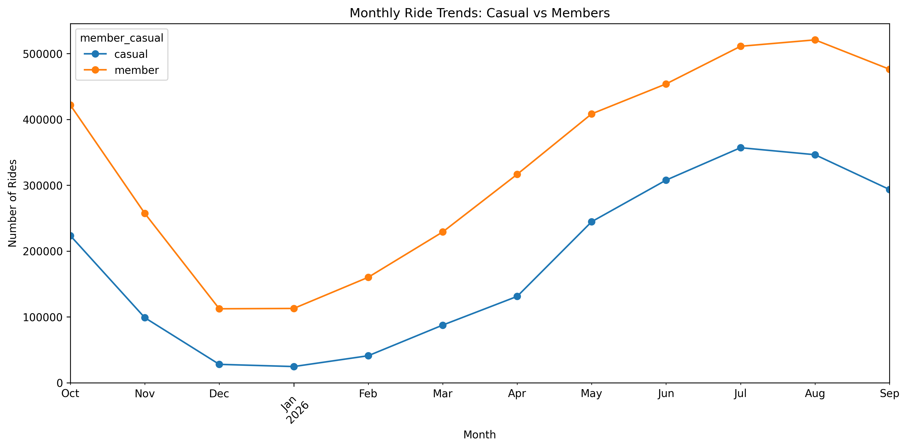
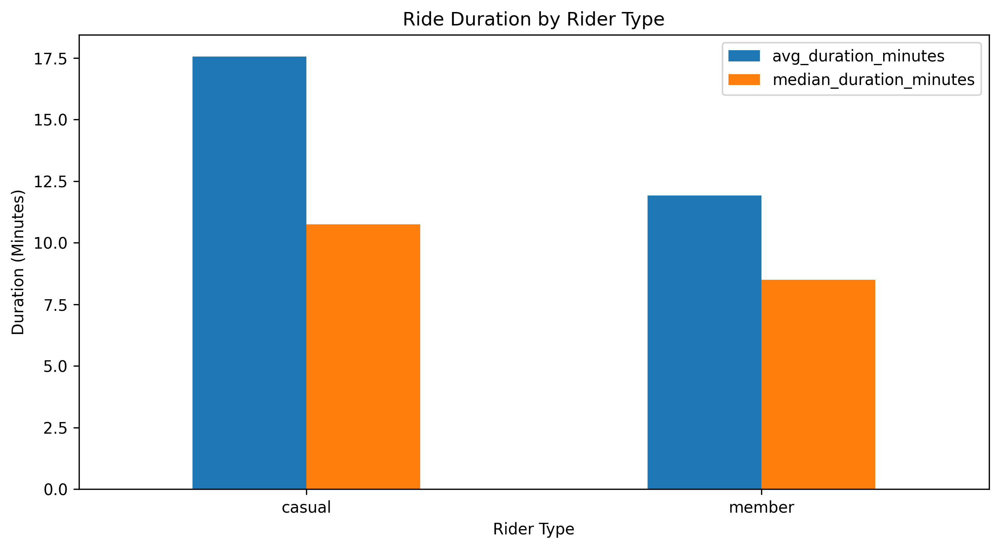
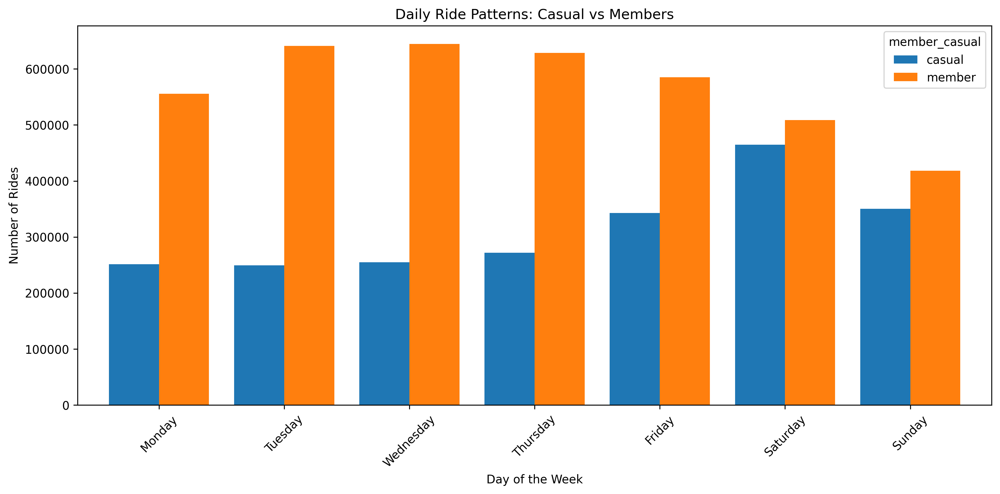

# Cyclistic Bike-Share Analysis

## Project Overview

This project analyses Cyclistic bike-share usage to understand
how annual members and casual riders use the service differently.

The goal is to identify usage patterns and recommend strategies
to convert more casual riders into annual members.

## Business Question

How do annual members and casual riders use Cyclistic bikes differently,
and how can Cyclistic convert more casual riders into annual members?

## Study Period

October 2025 – September 2026

## Tools Used

- Python
- SQL (DuckDB)
- Google Colab
- Pandas
- Matplotlib

## Data Preparation

- Combined 12 monthly CSV files.
- Removed 35 duplicate records.
- Reviewed missing values and retained records with incomplete
  station information.
- Excluded records with invalid ride durations or durations
  exceeding 24 hours.
- Final analysis dataset: 6,166,404 rides.

See `docs/data_cleaning.md` for details.

## Key Findings

### 1. Monthly Ride Trends

Annual members recorded more rides than casual riders in every
month of the study period. Both groups showed increased activity
during warmer months.

### 2. Ride Duration

Casual riders had longer rides than annual members.

- Casual riders: 17.56 minutes average duration.
- Annual members: 11.92 minutes average duration.

### 3. Day-of-Week Patterns

Casual riders showed stronger weekend usage, particularly on
Saturdays. Annual members recorded stronger weekday usage.

## Business Recommendations

1. Introduce weekend-focused membership promotions.
2. Promote annual membership benefits to frequent casual riders.
3. Launch seasonal membership campaigns during periods of
   increased riding activity.

These recommendations should be tested and evaluated to measure
their impact on membership conversions.

## Conclusion

The analysis indicates that casual riders tend to take longer
rides and are more active on weekends, while annual members
generate more rides overall and show stronger weekday usage.

Cyclistic can use these differences to develop targeted
marketing strategies aimed at converting casual riders into
annual members.

## Repository Structure

- `Cyclistic_Bike_Share_Analysis.ipynb` – Analysis notebook
- `Cyclistic_Data/` – Source data (not included in the public repository)
- `visualizations/` – Analysis charts
- `docs/` – Project documentation

## Data Source

Divvy trip data:
https://divvybikes-marketing.lyft.net/system-data

Raw source data is not included in this repository.

## AI Assistance and Acknowledgement

ChatGPT (OpenAI) was used as a learning and guidance assistant
throughout this project.

It provided step-by-step guidance on:
- Data preparation and cleaning.
- SQL queries using DuckDB.
- Python analysis and data visualisation.
- Understanding analytical findings.
- Developing business insights and recommendations.
- Organising and documenting the project.

The analysis, review and project decisions were completed
as part of my learning process, with AI assistance.

